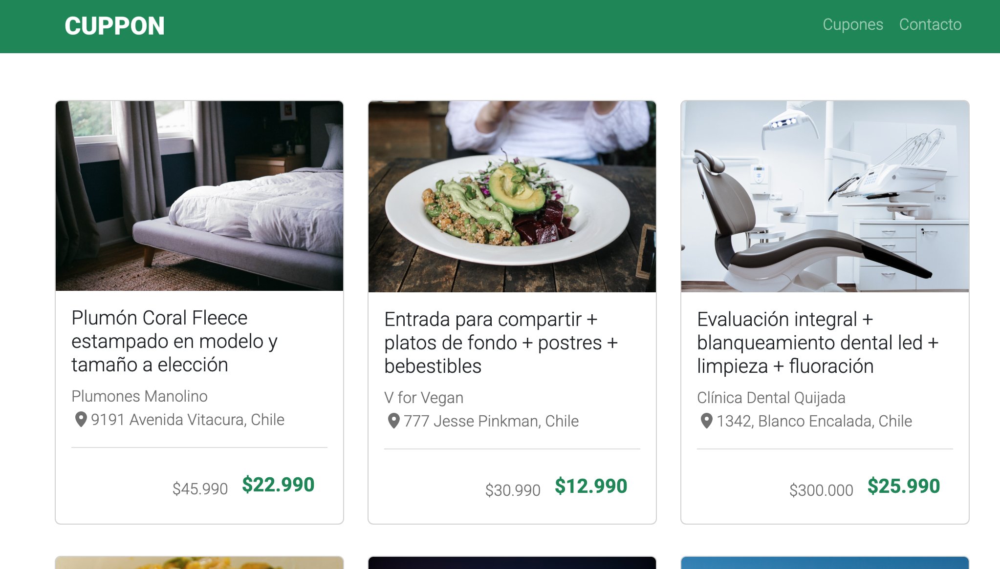

# 🎟️ Cuppon

Página web estática de cupones y ofertas de viajes, comida, salud y entretenimiento. Presenta las promociones en tarjetas, con precio normal y precio con descuento, e incluye un formulario para recibir cupones por correo. El diseño es responsivo y se adapta a celular, tablet y computador.

## 📸 Vista previa



## 🌐 Demo

Puedes ver el sitio publicado aquí: [https://pabloof-01.github.io/pagina_web_cuppon](https://pabloof-01.github.io/pagina_web_cuppon)

## 📋 Contenido de la página

- **Barra de navegación:** logo y menú con enlaces a Cupones y Contacto. En pantallas pequeñas se transforma en un menú hamburguesa.
- **Cupones:** seis tarjetas con imagen, descripción, ubicación y precios (normal y con descuento), distribuidas en dos filas de tres.
- **Contacto:** formulario con nombre y correo electrónico para recibir cupones.
- **Pie de página:** logo y aviso de derechos reservados.

## 🛠️ Tecnologías utilizadas

| Herramienta | Versión | Uso |
|---|---|---|
| HTML5 | — | Estructura de la página |
| CSS3 | — | Estilos propios |
| [Bootstrap](https://getbootstrap.com/) | 5.3.8 | Grilla, tarjetas, barra de navegación y formulario |
| [Font Awesome](https://fontawesome.com/) | Según kit | Íconos de ubicación |
| [Google Fonts](https://fonts.google.com/) | — | Tipografías Roboto, Open Sans y Raleway |

## 📁 Estructura del proyecto

```
cuppon/
├── index.html
├── README.md
└── assets/
    ├── css/
    │   └── style.css
    └── img/
        ├── logo-white.png
        ├── logo-black.png
        ├── cupon-1.jpg
        ├── cupon-2.jpg
        ├── cupon-3.jpg
        ├── cupon-4.jpg
        ├── cupon-5.jpg
        └── cupon-6.jpg
```

## 🚀 Cómo ejecutarlo

1. Clona el repositorio:

   ```bash
   git clone https://github.com/pabloof-01/pagina_web_cuppon.git
   ```

2. Entra en la carpeta del proyecto:

   ```bash
   cd cuppon
   ```

3. Abre el archivo `index.html` en tu navegador (doble clic o clic derecho → *Abrir con*).

No necesitas instalar nada ni tener un servidor: es una página estática.

> **Nota:** Bootstrap, Font Awesome y Google Fonts se cargan desde internet, por lo que necesitas conexión para ver la página con todos sus estilos e íconos.

## 👤 Autor

**Pablo Olivero**

- GitHub: [@tu-usuario](https://github.com/pabloof-01)
